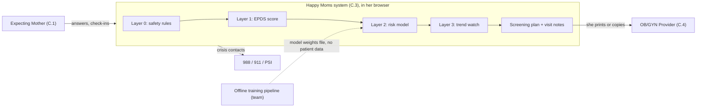
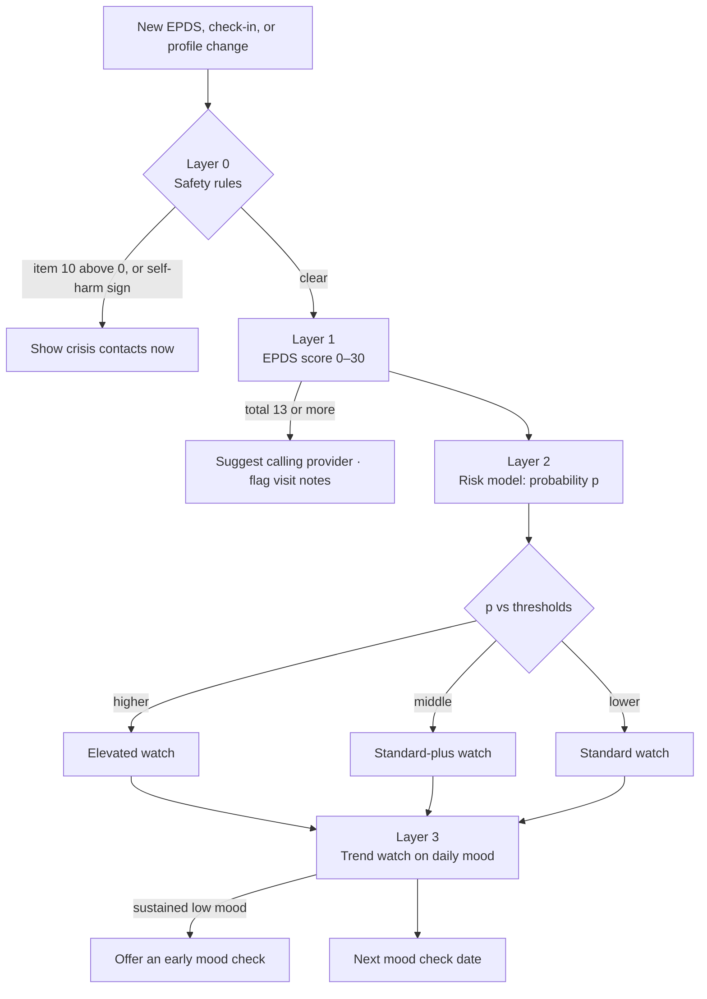
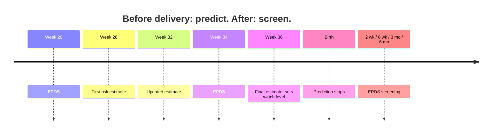
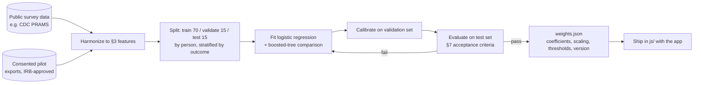

# Postpartum Depression Risk Algorithm: System Design

**Status:** Draft v0.1 · October 19, 2026 · Team 17, SYSEN 5151
**Source research:** Suryawanshi O, Pajai S. *A Comprehensive Review on Postpartum Depression.*
Cureus 2022;14(12):e32745 ([`post partum research.pdf`](post%20partum%20research.pdf))
**Related:** [`SPEC.md`](../SPEC.md) · [`docs/traceability.md`](../docs/traceability.md) (row 16: "UC.7
screening not built")

---

## 1. Purpose

This document describes how Happy Moms could estimate an expecting mother's risk of postpartum
depression (PPD), and how it would use that estimate. It covers the algorithm's layers, the data needed to
build it, how it is trained and validated, how it runs in the app, and the safety rules around it.

PPD affects about 10–15% of new mothers (paper, Table 1). The paper finds its risk factors are "more
strongly associated with social and psychological aspects than biological aspects." That makes most of
them things a mother can report herself, which is what makes an app-based estimate possible.

### Design principle

**The algorithm decides how closely to watch, not whether she is ill.** Its output changes how often the
app offers a mood check and what goes on her visit notes. She never sees a diagnosis or a risk percentage.
This keeps the feature inside the SPEC boundary ("the system never diagnoses or prescribes"), leaves the
clinical judgment with the provider, and still uses prediction to improve care.

### Prediction goal

**The risk estimate is made before delivery.** The first estimate is at pregnancy week 28 and the last at
week 36. Predicting early leaves time to act before the baby arrives: the provider can discuss prevention
and support options, such as counseling, and a postpartum plan can be in place before the birth. So the
model uses **only information available during pregnancy**. Anything that happens at or after birth,
such as an emergency C-section, a preterm delivery, the baby's health or baby blues, is left out of the
model. After birth, prediction stops and EPDS screening takes over.

---

## 2. Scope and boundary

| Inside the boundary | Outside the boundary |
| --- | --- |
| Scoring the EPDS questionnaire | Diagnosing PPD |
| Estimating risk from self-reported factors and check-ins | Prescribing or changing medicine |
| Deciding when to offer the next mood check | Contacting anyone on her behalf |
| Routing a self-harm answer to crisis contacts | Emergency response (the app only points to 988, 911, PSI) |
| Adding results to visit notes she chooses to share | Provider EHR systems |
| Running the trained model in the browser | Training the model (done offline by the team) |



---

## 3. What the research says to measure

The paper ("Psychological risk factors of PPD") groups risk factors by how strongly each is linked to PPD.
These groups are the starting feature list. The model learns the actual weights from data (§6); the
groups set our expectations and are used to sanity-check what it learns (§7.4). The **Before birth?**
column marks whether a factor is known in time to predict before delivery. Only factors marked "yes" are
model inputs.

| Group in the paper | Factors | Before birth? | Feature in Happy Moms | Source of the value |
| --- | --- | --- | --- | --- |
| **Strong** | Depression in pregnancy | yes | `epds_total_latest`, `epds_max`, `mood_mean_14d` | EPDS, daily check-in |
| **Strong** | Anxiety in pregnancy | yes | `epds_anxiety_3a` (items 3, 4, 5) | EPDS, no extra questions |
| **Strong** | History of depression | yes | `prior_depression`, `prior_ppd` | About me (yes / no / prefer not to say) |
| **Strong** | Lack of social support | yes | `support_level` (0–4) | About me, one question |
| **Strong** | Stressful life events | yes | `life_events_count` | About me checklist |
| **Raised risk** | Preeclampsia, prenatal hospitalization | yes | `preeclampsia`, `prenatal_hospital` | About me, updated at each scheduled mood check |
| **Strong** | Poor marital relationship | yes | `relationship_strain` | **Held**, safety review needed (O-4) |
| **Possible** | Methyldopa (blood pressure medicine) | yes | `bp_medication` | **Held**, reviewer decision (O-3) |
| **Strong** | Low self-esteem, neuroticism | yes | none | Not collected: no short validated item |
| **Weaker** | Low income, single status, unwanted pregnancy | yes | none | Not collected: weak link, sensitive to ask |
| **Strong** | Postpartum blues | **no** | none in the model | Happens after birth. EPDS screening covers it |
| **Raised risk** | Preterm delivery, emergency C-section, poor infant health | **no** | none in the model | Happen at or after birth. Recorded for the provider only |
| **Weaker** | Infant temperament | **no** | none | Only known after birth |
| Not in the paper | Sleep | yes | `sleep_hours_mean_14d`, `sleep_quality_mean_14d` | Daily check-in (already logged) |

Two strong predictors, depression and anxiety during pregnancy, are measured directly by the EPDS. So
the strongest signals in the paper are available before delivery.

The paper also reports that about **25%** of women who have had PPD before have it again. That makes
`prior_ppd` one of the most important inputs to collect.

---

## 4. Algorithm overview

The algorithm has four layers. Each one can override the one after it, and the safety layer always runs
first.



### Layer 0: safety rules (deterministic, always first)

| Trigger | Action |
| --- | --- |
| EPDS item 10 ("The thought of harming myself has occurred to me") answered anything but "Never" | Show crisis contacts before any score. Record result as `urgent` |
| Check-in urgent sign `selfHarm` | Existing crisis routing (`StR2.1`) |
| Check-in urgent sign `cannotCope` | Crisis contacts plus offer a mood check now |
| Assistant red flag, category `mental` | Existing assistant escalation |

No model output can suppress or delay a Layer 0 action.

### Layer 1: EPDS scoring (deterministic)

- 10 items, 4 answers each. Items 1, 2, 4 score 0–3 from the top answer down; items 3 and 5–10 are
  reverse-scored 3–0. Total 0–30.
- Anxiety sub-score EPDS-3A = items 3 + 4 + 5 (0–9).
- The paper uses **10 or more** as a positive screen. This design suggests **10–12** as "positive, discuss
  at the next visit" and **13 or more** as "positive, call the provider soon." The clinical reviewer
  confirms both cutoffs (O-1).
- A positive EPDS always acts directly. It never waits on the risk model.

### Layer 2: risk model (learned)

Estimates `p`, the probability of a positive EPDS (13 or more) at 6 weeks after birth, from the
before-birth features in §3. It runs at pregnancy weeks 28, 32 and 36 (§5.5). Details in §5–§7. Before a trained model exists, Layer 2 uses the interim rule in §5.4.

`p` is never shown to her as a number. It sets her **watch level**:

| Watch level | Extra mood checks | Visit notes |
| --- | --- | --- |
| Standard | Base schedule only (§8.2) | Screening results, if she opts in |
| Standard-plus | Base schedule plus one extra check at pregnancy week 38 | Plus "factors you might want to mention" |
| Elevated | Every 4 weeks from week 28 to 6 months after birth | Plus a line suggesting she ask about prevention and support options |

The thresholds between levels are chosen at validation (§7.3), not set in advance.

### Layer 3: trend watch (deterministic)

Uses the daily check-ins she already does:

- **Low mood run:** mood 2 or lower on at least 10 of the last 14 days, with at least 7 days logged.
  Offers an early mood check.
- **Drop from baseline:** 14-day mean mood at least 1.0 below her baseline period mean. Offers an early
  mood check.
- **Pause:** neither rule fires on days 1–10 after birth (the paper: baby blues usually ease by day 10).
- **Rate limit:** at most one early offer every 14 days.

All Layer 3 thresholds are preliminary and are tuned on pilot data (§9, phase 3).

---

## 5. The risk model

### 5.1 Prediction target

| Choice | Value | Why |
| --- | --- | --- |
| Outcome | EPDS 13 or more, or a clinical PPD diagnosis | Standard "probable depression" cutoff; a diagnosis is a stronger label when available |
| Time point | 6 weeks after birth (window 4–8 weeks) | Matches the routine postpartum visit; inside the paper's DSM-5 and ICD windows |
| Prediction point | Pregnancy week 28, updated at 32 and 36 | Week 28 follows the week 26 EPDS and leaves about 12 weeks before a due date to arrange support. Counseling-based prevention usually runs over several sessions |
| Population | People with a live birth, 18 or older | Matches the app's users |

### 5.2 Model choice

**Penalized logistic regression** (L2 or elastic net) as the main model.

- It is interpretable: each factor gets one weight that the team and the reviewer can check against the
  paper's groupings.
- It runs in the browser as a short list of numbers, with no library and no server.
- On small and mid-sized tabular health data, it usually performs about as well as complex models.

A **gradient-boosted tree model** is trained as a comparison. It replaces logistic regression only if it is
clearly better on held-out data (AUROC at least 0.03 higher with overlapping calibration) and the team
accepts the added complexity.

```
p = 1 / (1 + exp(-(b0 + b1*x1 + b2*x2 + ... + bk*xk)))
```

Coefficients `b0…bk` are learned in training (§6). No coefficient is set by hand.

### 5.3 Feature handling

| Issue | Rule |
| --- | --- |
| Missing answers | "Prefer not to say" and unanswered are both coded as missing, plus a 0/1 "missing" flag per feature. Missingness can be informative |
| Sparse check-ins | Trend features need 7 or more logged days in the window; otherwise missing |
| Scaling | Continuous features standardized with the training mean and standard deviation, which ship in the weights file |
| Counts | `life_events_count` capped at 3. `preeclampsia` and `prenatal_hospital` are 0/1 flags |
| Leakage | No feature measured after the prediction point. Nothing from labor, birth or after birth is ever a model input |
| Early delivery | If the baby arrives before week 36, the most recent estimate stands; nothing is re-predicted after birth |

### 5.4 Interim rule before a trained model exists

Until §6 produces a validated model, Layer 2 uses a transparent rule, documented as a placeholder:

```
strong = count of: prior_ppd, prior_depression, epds_total_latest >= 10,
                   epds_anxiety_3a >= 6, support_level <= 1, life_events_count >= 2
watch_level = elevated       if prior_ppd or strong >= 3
            = standard-plus  if strong >= 1
            = standard       otherwise
```

This rule only changes how often mood checks are offered. It makes no claim about a probability, so it
needs no fitted weights.

### 5.5 Prediction timeline

One antenatal model runs at three points. Each run uses the latest values of the same features.

| When | Uses | What it's for |
| --- | --- | --- |
| Week 28 | Week 26 EPDS, history, support, life events, 14-day mood and sleep | First estimate. Leaves the most time to arrange support |
| Week 32 | Same features, refreshed | Catches changes in mood, support or complications |
| Week 36 | Week 34 EPDS and refreshed features | Final estimate before delivery. Sets the watch level for after birth |
| After birth | No new prediction | The week 36 watch level carries over. EPDS screening at 2 weeks, 6 weeks, 3 months and 6 months takes over |

The watch level can rise between runs but never drops below the level set by an earlier run in the same
pregnancy. A dip in risk late in pregnancy is not a reason to watch less after birth.



---

## 6. Data and training pipeline

The app collects no research data by default. Training happens offline, on a dataset the team obtains
with approval, and produces a weights file with **no patient data in it**.



### 6.1 Candidate data sources

| Source | What it has | Fit | Access |
| --- | --- | --- | --- |
| **CDC PRAMS** (Pregnancy Risk Assessment Monitoring System) | Large US survey after live birth. Postpartum depressive symptom questions, stressful life events, prior depression, birth complications | Strongest fit for the antenatal model. Outcome is self-reported symptoms, not the EPDS | Research proposal to CDC |
| **Published cohort studies** | EPDS at several time points with risk factors | Good outcome label | Data-sharing agreement with study authors |
| **Happy Moms pilot** | Exactly our features and EPDS at 6 weeks | Best match, but small | Opt-in research export, IRB approval, consent |

The model is first trained on PRAMS or a cohort, then checked on pilot data, where it would be
recalibrated.

**Timing caveat for predicting before delivery.** PRAMS surveys mothers a few months *after* birth, so its
answers about pregnancy (depression before or during pregnancy, stressful events) are remembered later.
Someone who is depressed after birth may remember her pregnancy as worse than she reported it at the
time, which can make those factors look more predictive than they will be in the app. A **prospective
cohort**, where answers were recorded during pregnancy and the outcome measured after birth, matches
how the app works and is the better source for this goal. If PRAMS is used, results must be checked on
prospective data (a cohort or the pilot) before release.

### 6.2 Sample size

With a 10–15% outcome rate and about 15 candidate features, plan for **at least 1,500–2,000
pregnancies**, about 150–300 outcome events, for the main model. The pilot alone will not reach this. It is
used only for external validation and recalibration.

### 6.3 Weights file contract

```json
{
  "model": "ppd-antenatal",
  "version": "0.1.0",
  "trainedOn": "PRAMS phase 8, 2016-2020",
  "target": "EPDS>=13 or PPD dx at 4-8 weeks postpartum",
  "intercept": -2.10,
  "features": [
    { "name": "prior_ppd", "type": "binary", "coef": 0.0, "missingCoef": 0.0 },
    { "name": "epds_total_latest", "type": "continuous", "mean": 0.0, "sd": 1.0, "coef": 0.0 }
  ],
  "calibration": { "method": "platt", "a": 1.0, "b": 0.0 },
  "thresholds": { "standardPlus": 0.0, "elevated": 0.0 },
  "validation": { "auroc": null, "sensitivityAtElevated": null }
}
```

All numbers above are placeholders showing the shape. Real values come only from training.

---

## 7. Validation and acceptance

### 7.1 Metrics

| Metric | What it tells us | Acceptance target (preliminary) |
| --- | --- | --- |
| AUROC | How well the model ranks higher-risk above lower-risk | 0.70 or higher on the test set |
| Sensitivity at the elevated threshold | Share of true cases put on elevated watch | 0.75 or higher |
| Specificity at the elevated threshold | Share of non-cases kept off elevated watch | Reported. Traded off against sensitivity |
| Calibration slope and intercept | Whether predicted probabilities match observed rates | Slope 0.8–1.2 |
| Brier score | Overall accuracy of the probabilities | Better than the base-rate model |
| Subgroup gaps | Fairness across race and ethnicity, age band, insurance type | AUROC within 0.05 of overall; sensitivity within 0.10 |

### 7.2 Why sensitivity comes first

A missed case (false negative) means less watching for someone who needed more. A false alarm means a
few extra 10-question checks. Thresholds are therefore set for sensitivity first. The cost of a false alarm
stays low because Layer 2 only changes how often checks are offered.

### 7.3 Choosing thresholds

On the validation set, `elevated` is the lowest `p` that keeps sensitivity at or above 0.75, and
`standardPlus` is set so that about the top 40% of predicted risk gets more than the base schedule. Both
thresholds are frozen before the test set is opened.

### 7.4 Sense checks against the research

- Factors the paper calls **strong** should have positive weights. A strong factor with a near-zero or
  negative weight is investigated before release.
- `prior_ppd` and `epds_total_latest` are expected to be among the largest weights.
- Any factor the paper doesn't list that ends up with a large weight is reviewed for leakage.

### 7.5 Ongoing monitoring

For pilot users who opt in, compare the share of each watch level that later screens positive. If an
elevated rate falls below the standard rate, or calibration drifts past the §7.1 limits, the model is
retrained or rolled back to the interim rule.

---

## 8. Running it in the app

### 8.1 Modules

| Module | Job | Notes |
| --- | --- | --- |
| `js/hm-screening.js` | EPDS items, scoring, Layer 0 item-10 check, Layer 1 bands, base schedule | Pure functions |
| `js/hm-risk.js` | Builds the feature vector from state, applies `weights.json` or the interim rule, returns the watch level | Pure functions. No network |
| `js/hm-signals.js` | Layer 3 trend rules over `checkins` | Pure functions |
| `js/ppd-weights.js` | The weights file as a script (`HM.ppdWeights = {...}`) so it loads from `file://` and GitHub Pages | Generated by the pipeline |
| `html/mood-check.html` | The 10-item EPDS, one item per screen, and the result screen | Login-gated |
| `js/hm-summary.js` (changed) | Opt-in mood screening block on visit notes | Existing |
| `js/hm-app.js` (changed) | "Mood check due" card on Today | Existing |

### 8.2 Base screening schedule

Sign-up, pregnancy weeks 12, 26 and 34, then 2 weeks, 6 weeks, 3 months and 6 months after birth. The
watch level adds checks on top of this (§4, Layer 2). The first check after birth is at 2 weeks so that baby
blues (days 1–10) aren't mistaken for PPD.

### 8.3 Interface

```js
HM.screening.score(answers)          // -> { total, anxiety3A, item10, band: "urgent"|"positive"|"call"|"below" }
HM.screening.nextDue(state, today)   // -> { date, reason: "scheduled"|"watch"|"early" } or null
HM.risk.features(state, today)       // -> { prior_ppd: 1, epds_total_latest: 11, ... } with missing flags
HM.risk.assess(state, today)         // -> { level: "standard"|"standard-plus"|"elevated",
                                     //      source: "model"|"interim", version, factors: [...] }
HM.signals.offerEarly(state, today)  // -> { offer: true, rule: "lowMoodRun" } or { offer: false }
```

`HM.risk.assess` returns `factors`, the list of reported factors to show on visit notes. It never returns
`p` to any screen.

### 8.4 Data contract additions

Added to the per-account state in `HM.store` (`happymoms.v1.<user id>`). `migrate()` fills defaults for
existing accounts. Export and delete cover them automatically.

```js
screenings: [{
  id, instrument: "EPDS", takenOn: "YYYY-MM-DD",
  phase: "pregnancy" | "postpartum", week,
  trigger: "scheduled" | "watch" | "early" | "cannotCope" | "self",
  answers: [/* option index 0-3 for each of 10 items */],
  total, anxiety3A, band,
  shareOnNotes: false
}],
riskProfile: {
  updatedAt, priorDepression, priorPpd, supportLevel,
  lifeEvents: [], pregnancyComplications: [],   // e.g. "preeclampsia", "prenatalHospital"
  birthEvents: [],                              // recorded for the provider, never a model input
  shareOnNotes: false
},
riskAssessments: [{ at, gestationalWeek, level, source, modelVersion }]   // levels only, never p
```

Answers are stored as the option chosen, not as points, so past checks can be re-scored if the key or
cutoffs change.

---

## 9. Build plan

| Phase | Delivers | Needs | Verifies |
| --- | --- | --- | --- |
| **1. Screening skeleton** | Layer 0 + Layer 1, `mood-check.html`, result screen | Nothing new | StR7.2, StR7.3, StR7.6 |
| **2. Schedule and notes** | Base schedule, Today card, opt-in visit-notes block | Phase 1 | StR7.1, StR7.4, StR7.5 |
| **3. Trend watch** | Layer 3 in `hm-signals.js` | Phase 1 | StR7.7 |
| **4. About me + interim rule** | Risk-factor questions, `hm-risk.js` with §5.4 rule | Phase 2 | StR7.8 |
| **5. Trained model** | Pipeline (§6), `ppd-weights.js`, model in `hm-risk.js` | Dataset access, IRB if pilot data | StR7.9, §7 targets |

Phases 1–4 can ship in this course. Phase 5 depends on data access, which is outside the team's control
(O-2).

---

## 10. Requirements draft (for SPEC.md)

**N-10 Early notice of perinatal depression.** *Expecting mothers need signs of depression during and after
pregnancy noticed early and brought to their provider.* (PN-10, to add in Innoslate)

| Req | The Happy Moms system shall… | Acceptance criterion | Check (to write) |
| --- | --- | --- | --- |
| StR7.1 | Offer the EPDS on the base schedule in §8.2. | Each check offered within ±7 days of its target for test profiles. | `N-10 schedule follows the profile` |
| StR7.2 | Score the EPDS according to its published key. | 100% agreement with hand-scored test vectors. | `N-10 EPDS scoring matches the key` |
| StR7.3 | Show crisis contacts within 2 s of any item-10 answer other than "Never," before any score. | Every such test response shows contacts in ≤ 2 s, before the total. | `N-10 self-harm answer routes to urgent help` |
| StR7.4 | Recommend contacting the provider when the EPDS total is 13 or more. | 100% of such test vectors show the recommendation. | `N-10 high score recommends the provider` |
| StR7.5 | Include screening results and factors on visit notes only after she opts in. | Zero inclusions without opt-in. | `N-10 results stay off notes until shared` |
| StR7.6 | Never present a score, factor or risk estimate as a diagnosis or a percentage. | Language check finds zero such statements; no screen renders `p`. | `N-10 screening copy does not diagnose` |
| StR7.7 | Offer an early mood check when a Layer 3 rule fires, at most once per 14 days, paused on days 1–10 after birth. | Test histories trigger exactly when rules hold. | `N-10 trend watch offers an early check` |
| StR7.8 | Assign a watch level from her reported factors, and add the matching extra mood checks. | Test profiles get the level the active rule or model specifies. | `N-10 watch level follows the rule` |
| StR7.9 | Use a trained risk model only if it meets the §7.1 targets on held-out data. | Validation report attached to the model version. | Release checklist |
| StR7.10 | Produce a risk estimate before delivery, at pregnancy weeks 28, 32 and 36, using only information recorded before birth. | For test profiles, an estimate exists at each week, and no estimate uses a feature dated on or after the birth date. | `N-10 risk is estimated before delivery` |

---

## 11. Safety, ethics and regulation

| Hazard | Mitigation |
| --- | --- |
| Self-harm answer missed or delayed | Layer 0 runs first and synchronously; crisis page stays plain HTML; StR7.3 tested |
| Model under-rates someone at real risk | Model only adds watching; EPDS results always act on their own; no level reduces checks below the base schedule |
| She reads her level as a diagnosis | Level is never named on screen; she sees "We'll check in a little more often" |
| Low EPDS read as "all clear" | Every result says a lower score doesn't rule anything out, with a provider link |
| Bias against groups under-represented in training data | Subgroup checks in §7.1; release blocked if gaps exceed limits |
| Someone else sees her answers | Login-gated per account; nothing on Today; off the notes by default |
| Asking about medicine leads her to stop it | Question held pending review (O-3); any wording says keep taking it as prescribed |
| Data leaves the device without consent | Inference runs in the browser; the research export is a separate, explicit, consented action |

**Regulation.** An app that gives an individual a risk estimate for a condition is likely regulated as
Software as a Medical Device by the FDA. This design reduces that exposure: no risk number is shown, the
output only changes how often a validated screener is offered, and a clinician makes all diagnosis and
treatment decisions. The team should still record a regulatory assessment as an ADR before Phase 5.

**Research ethics.** Any use of real users' data to train or validate the model is human-subjects
research. It needs IRB approval and informed consent, and the research export must stay separate from
normal use of the app.

---

## 12. Open issues

| ID | Issue | Resolution path |
| --- | --- | --- |
| O-1 | Who confirms the EPDS cutoffs (10, 13) and the result wording? | Find a clinical reviewer (OB/GYN, perinatal psychiatrist, nurse midwife); also covers StR3.3 |
| O-2 | Which training dataset, and can we get it in time? | Draft a PRAMS data request, or contact a cohort study team; fall back to the interim rule |
| O-3 | Ask about blood pressure medicine (methyldopa)? | Reviewer decision; the paper's evidence is mostly mechanistic |
| O-4 | Partner-relationship questions on a shared device | Reviewer decision; consider omitting and linking the domestic violence hotline from urgent help |
| O-5 | EPDS terms of use and attribution | Confirm reproduction terms; cite Cox, Holden & Sagovsky (1987) on screen |
| O-6 | SPEC §1 says "never diagnoses"; screening and risk-guided scheduling must be placed explicitly | Add to §1: "screens with validated instruments, adjusts screening frequency, and routes results to the provider"; record ADR |
| O-7 | Model and requirement updates | Add PN-10, N-10, StR7.1–7.9 and the UC.7 sequence to Innoslate; update `traceability.md` row 16 |

---

## 13. References

1. Suryawanshi O, Pajai S. A Comprehensive Review on Postpartum Depression. *Cureus* 2022;14(12):e32745.
   doi:10.7759/cureus.32745
2. Cox JL, Holden JM, Sagovsky R. Detection of postnatal depression: development of the 10-item Edinburgh
   Postnatal Depression Scale. *Br J Psychiatry* 1987;150:782–6.
3. Robertson E, Grace S, Wallington T, Stewart DE. Antenatal risk factors for postpartum depression: a
   synthesis of recent literature. *Gen Hosp Psychiatry* 2004;26(4):289–95.
4. Beck CT. Predictors of postpartum depression: an update. *Nurs Res* 2001;50(5):275–85.
5. American College of Obstetricians and Gynecologists. Clinical Practice Guideline No. 4: Screening and
   Diagnosis of Mental Health Conditions During Pregnancy and Postpartum. 2023.
6. Centers for Disease Control and Prevention. Pregnancy Risk Assessment Monitoring System (PRAMS).
